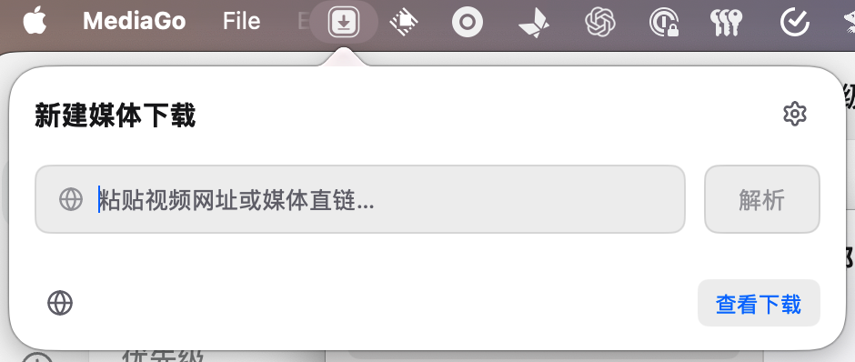
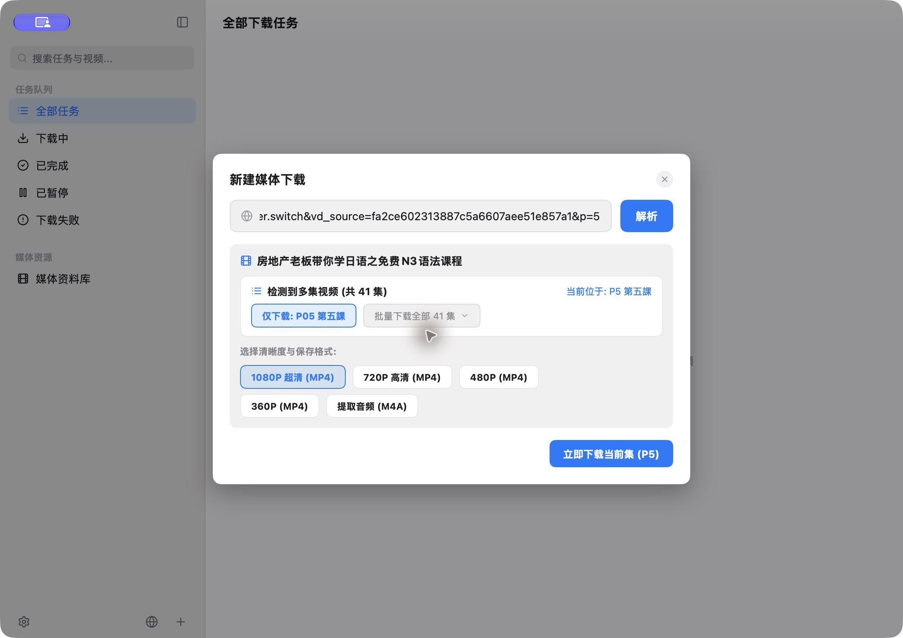
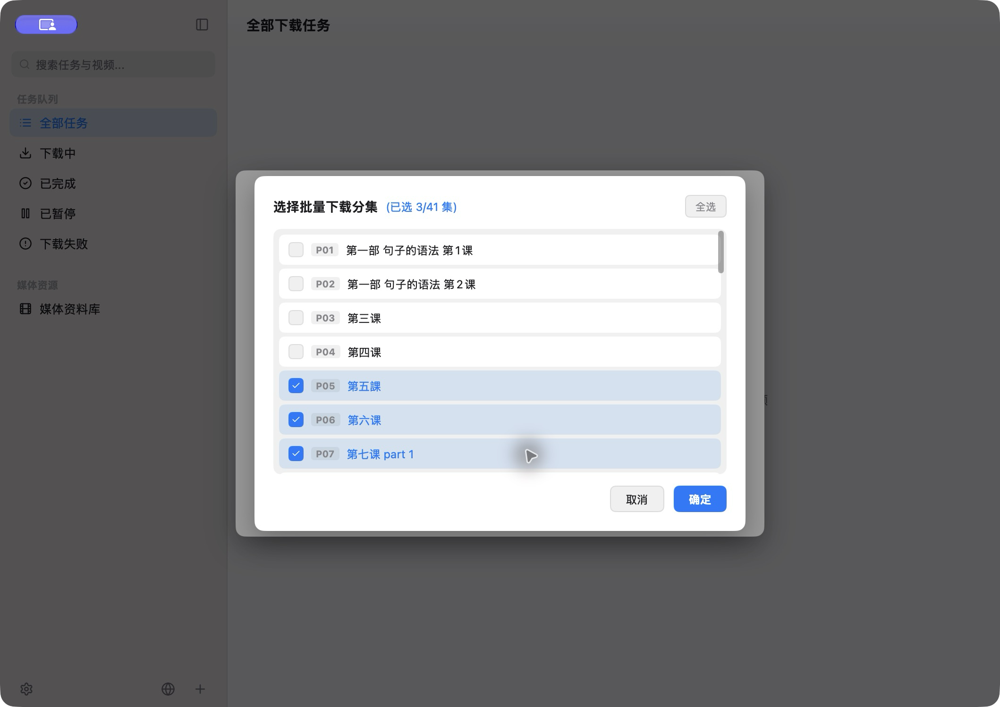
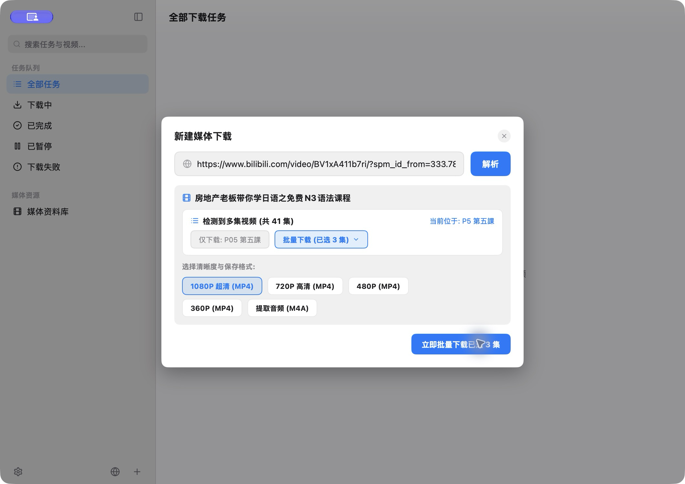

# MediaGo

English | [简体中文](README.zh-CN.md)

A native, high-performance media sniffer and universal downloader for macOS, written in Go with [MyGo](https://mygo.egoist.dev)'s native UI. No Electron, no webview overhead in the main application: the UI is drawn by MyGo directly on the GPU via Metal, with the system's fonts, accent color, dark mode, menus and vibrancy.


## What it does

- **Menu bar downloads**: Parse a URL, choose formats or episodes, and queue downloads from a compact native panel. Right-click for the main window, download folder, settings, or quit. Disable the entry in General settings; while enabled, downloads continue after closing the main window.

- **Multi-Tab Sniffer Browser**: Built-in tabbed browser with independent sniffing sessions. Automatically detects media streams, provides in-place quality extraction and selection, and supports direct-stream fallback download when authentication restricts CLI tools.
- **High-Speed Concurrent Engine**: Native HTTP Range chunking engine with `206 Partial Content` probing, EWMA smooth speed estimation, and parallel HLS/M3U8 stream segment pulling with automatic `ffmpeg` remuxing.
- **MyGo Native UI**: Built with MyGo's GPU-rendered AppKit interface. Automatically tracks macOS system accent colors, adapts between light and dark appearances, and offers smooth vibrancy blur containers.
- **Multi-Episode Batch Selection**: Automatically discovers multi-part video series (such as Bilibili multi-P collections) and provides a modal to select individual episodes or batch-download the entire playlist.
- **Media Library & Integrity Watcher**: Tracks downloaded assets with real-time filesystem synchronization. Files deleted in Finder are automatically grayed out as invalid, with support for revealing in Finder and system default player playback.
- **Zero-CGO SQLite WAL Storage**: Robust task state persistence powered by pure Go SQLite in WAL mode, ensuring thread-safe concurrency and smooth migrations.

## Screenshots

### Menu bar downloads

Open the panel from the macOS menu bar to parse a URL. The bottom controls open the built-in browser and the download queue.



### Series discovery and episode selection

These screenshots use [episode 5 of the example course](https://www.bilibili.com/video/BV1xA411b7ri/?p=5). MediaGo discovers all 41 episodes and identifies P5, “第五課”, as the current episode.

Parse the URL and choose a format, then select all episodes or a subset. This example selects P5, P6, and P7 before returning to the batch download form.

<table>
<tr><th>Discover the series and current episode</th><th>Select individual episodes</th></tr>
<tr>
<td></td>
<td></td>
</tr>
</table>



### Built-in sniffer browser

Parse the same P5 page in the browser, choose a format, and switch between the current episode and batch episode selection.


## Architecture

| Component | Description |
|---|---|
| `cmd/mediago` | Application entry point, window bootstrap, and subsystem coordinator |
| `internal/ui` | Native AppKit interface powered by MyGo (sidebar, task queue, dialogs, modals, and settings) |
| `internal/browser` | Integrated multi-tab WKWebView browser with web media request interception and in-place resolution UI |
| `internal/engine` | Core HTTP range chunking, HLS stream parser, and two-level concurrency download scheduler |
| `internal/discovery` | URL normalization, parameter cleaning, and controlled `yt-dlp` format extractor |
| `internal/library` | Local media file management, integrity verification, and Finder / Quick Look integration |
| `internal/storage` | Pure Go SQLite engine with WAL mode and schema auto-migration |
| `internal/model` | Core domain entities (`Task`, `Candidate`, `Episode`, `Asset`, `Status`) |

## Develop and build

MediaGo requires [Go](https://go.dev/dl/) 1.27+ and macOS 13+.

External CLI tools (with built-in one-click in-app auto-installer and hot update support):
- [ffmpeg](https://ffmpeg.org/): For HLS segment remuxing and audio/video stream joining.
- [yt-dlp](https://github.com/yt-dlp/yt-dlp): For deep stream format extraction across video platforms.
> *Note: MediaGo automatically reuses system installations if present. If missing, the app features an integrated cross-platform downloader (macOS / Windows / Linux) that can install and update them into your user data directory with a single click in the main window banner or Settings.*

```sh
# Run locally in development mode
go run ./cmd/mediago

# Run tests
go test ./...

# Build signed macOS application bundle (MediaGo.app)
./scripts/build_app.sh

# Rebuild high-resolution app icon assets
python3 scripts/build_production_icon.py
```

## Credits

- [MyGo](https://mygo.egoist.dev/) - Native macOS UI framework in Go.
- [yt-dlp](https://github.com/yt-dlp/yt-dlp) - Media format discovery and extraction.
- [Lucide Icons](https://lucide.dev) - Clean vector iconography.

## License

MIT
