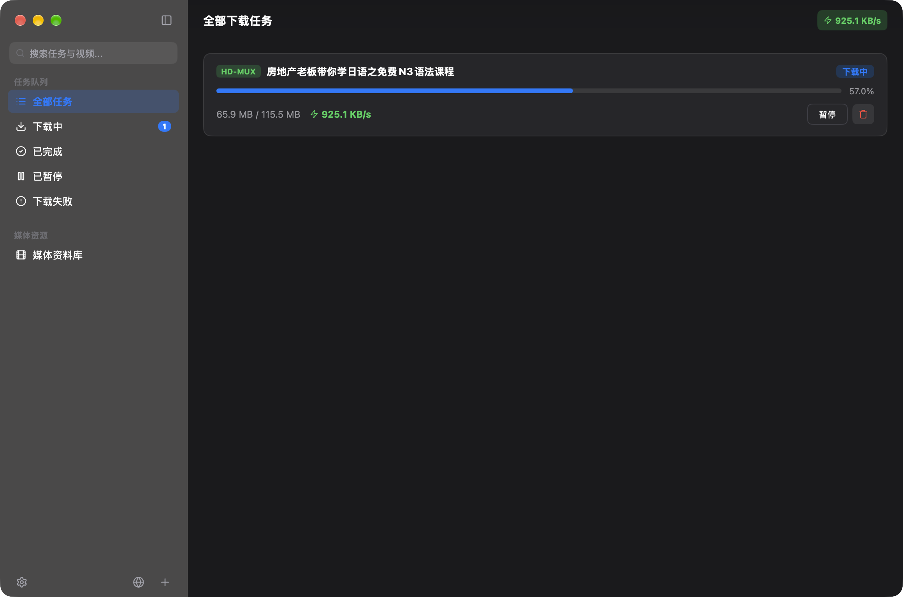

# MediaGo

[English](README.md) | 简体中文

一款专为 macOS 设计的现代化原生流媒体嗅探与高速下载管理器。采用 Go 语言结合 [MyGo](https://mygo.egoist.dev) 原生 UI 框架开发。主程序无 Electron、无 Webview 内存负担：窗口由 MyGo 通过 Metal GPU 直接在显卡上完成硬件加速绘制，深度融合 macOS 原生字体、系统 Accent 强调色、深浅色模式切换、原生菜单与毛玻璃模糊效果。



## 核心特性

- **多标签页嗅探浏览器**：内置多标签页浏览器，各标签页独立嗅探网络流媒体。自动探测网页媒体请求，支持在右下角卡片就地完成清晰度规格解析与下拉选择；在遇到反爬登录受限时，支持一键“直接下载嗅探直链”兜底保障。
- **高性能两级并发引擎**：纯 Go 实现 HTTP Range 分段切片下载引擎，支持 `206 Partial Content` 自动探测与断点续传；基于 EWMA 算法提供平滑实时测速；支持 HLS/M3U8 多分片并发拉取并自动调用 `ffmpeg` 进行无损混流封装。
- **MyGo 原生 UI 体验**：基于 MyGo 的 GPU 原生 AppKit 界面开发。色彩实时跟随 macOS 系统 Accent 强调色偏好，无缝适配系统浅色与深色外观，提供平滑的原生模糊容器效果，无掉帧与白屏闪烁。
- **分 P 视频智能批量多选**：自动识别 Bilibili 等站点的多 P 视频集合，提供原生的分 P 批量多选模态框，支持全选、反选、多选与单集名称动态展示。
- **媒体资料库与文件状态感知**：对已下载媒体文件建立索引与本地监听。用户在 Finder 中手动删除的文件会自动在资料库与已完成列表中置灰标示为“已失效”；支持在 Finder 中定位文件以及调用系统默认播放器打开。
- **零 CGO 纯 Go SQLite 持久化**：基于 SQLite WAL 模式存储任务状态与历史记录，无 cgo 外部动态链接开销，保证高并发线程安全与架构自愈迁移。


## 架构划分

| 模块组件 | 功能说明 |
|---|---|
| `cmd/mediago` | 应用程序入口，窗口初始化与各核心子系统协同管理 |
| `internal/ui` | 基于 MyGo 的原生 AppKit 界面（侧边栏、任务队列、模态框、设置页） |
| `internal/browser` | 专用无标题栏多标签 WKWebView 浏览器，流媒体请求网络拦截与就地解析卡片 |
| `internal/engine` | HTTP Range 切片引擎、HLS 解析器与两级并发调度下载引擎 |
| `internal/discovery` | URL 规范化过滤与受控 `yt-dlp` 视频多规格探测解析器 |
| `internal/library` | 本地媒体资料库管理、文件完整性校验及 Finder / Quick Look 联动 |
| `internal/storage` | 纯 Go SQLite WAL 模式存储引擎与 Schema 自动迁移机制 |
| `internal/model` | 核心领域模型定义（`Task`, `Candidate`, `Episode`, `Asset`, `Status`） |

## 开发与构建

运行与编译 MediaGo 需要环境满足 [Go](https://go.dev/dl/) 1.27+ 与 macOS 12+。

外部依赖工具（已内置应用内「一键自动配置」与热更新支持）：
- [ffmpeg](https://ffmpeg.org/): 用于 HLS 分片合并、音视频流自动混流转码。
- [yt-dlp](https://github.com/yt-dlp/yt-dlp): 用于各流媒体站点的高清规格探测与提取。
> *提示：MediaGo 会优先复用系统已有环境；若未安装，App 内置了跨平台（macOS / Windows / Linux）自动下载器，可在主界面横幅或偏好设置「关于」中一键安装至独立数据目录并支持在线热更新。*

```sh
# 本地开发模式运行
go run ./cmd/mediago

# 运行自动化测试
go test ./...

# 一键打包 macOS 原生应用程序 (MediaGo.app)
./scripts/build_app.sh

# 重新生成多分辨率高清应用图标资产
python3 scripts/build_production_icon.py
```

## 致谢

- [MyGo](https://mygo.egoist.dev/) - 基于 Go 语言的现代 macOS 原生 UI 框架。
- [yt-dlp](https://github.com/yt-dlp/yt-dlp) - 强大的流媒体格式分析与探测工具。
- [Lucide Icons](https://lucide.dev) - 清爽简洁的矢量图标集。

## 许可证

MIT License
